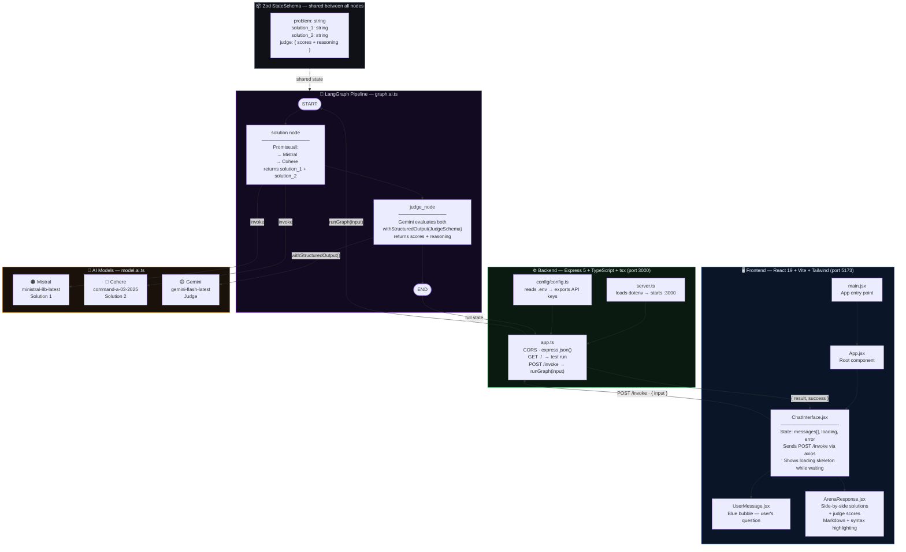

# ⚔️ AI Chat Arena

A full-stack AI application where you submit any problem, **two AI models compete** to give the best answer, and a **third AI judges** who won — complete with scores and reasoning.

Built with **React + Vite** on the frontend, **Express + TypeScript** on the backend, and **LangGraph** to orchestrate the AI pipeline using **Mistral**, **Cohere**, and **Google Gemini**.

---

## 🎯 What Does This Project Do?

1. You type any question or problem in the chat UI
2. **Mistral AI** and **Cohere** both generate answers simultaneously (in parallel)
3. **Google Gemini** reads both answers and judges them — giving each a score out of 10 with detailed reasoning
4. The UI shows both answers side-by-side with the judge's verdict

It's like a boxing match for AI models.

---

## 🗺️ Architecture Diagram



---

## 🔁 How a Request Flows (Step by Step)

```
1.  User types a problem in the chat input
2.  ChatInterface.jsx → POST http://localhost:3000/invoke  { input: "problem text" }
3.  Express app.ts receives the request
4.  app.ts calls runGraph(input)
5.  LangGraph: START → solution node
6.  solution node fires Mistral + Cohere simultaneously (Promise.all)
7.  Both answers land in shared state: solution_1, solution_2
8.  LangGraph: solution node → judge_node
9.  judge_node sends problem + both answers to Gemini
10. Gemini returns structured JSON: { solution_1_score, solution_2_score, reasoning... }
11. LangGraph: judge_node → END
12. runGraph() returns the full state object
13. Express responds: { message, success: true, result }
14. ChatInterface replaces loading skeleton with ArenaResponse
15. ArenaResponse renders solutions side-by-side with judge scores
```

---

## 📁 Project Structure

```
day44/
├── README.md                      ← you are here
│
├── backend/
│   ├── server.ts                  ← entry: loads .env, starts Express on :3000
│   ├── .env                       ← API keys (never commit this!)
│   ├── tsconfig.json              ← TypeScript config (module: nodenext)
│   ├── package.json
│   └── src/
│       ├── app.ts                 ← Express app, CORS, route handlers
│       ├── ai/
│       │   ├── graph.ai.ts        ← LangGraph pipeline (core logic)
│       │   └── model.ai.ts        ← Gemini, Mistral, Cohere instances
│       ├── config/
│       │   └── config.ts          ← reads .env, exports typed config object
│       └── services/
│           └── ai.service.ts      ← (placeholder / future service layer)
│
└── frontend/
    ├── index.html                 ← Vite HTML shell
    ├── vite.config.js             ← Vite + React + Tailwind plugins
    ├── package.json
    └── src/
        ├── main.jsx               ← React root mount
        └── app/
            ├── App.jsx            ← root component, renders ChatInterface
            ├── index.css          ← @import "tailwindcss"
            └── components/
                ├── ChatInterface.jsx   ← core UI, state, API calls, skeleton
                ├── UserMessage.jsx     ← user message bubble
                └── ArenaResponse.jsx  ← side-by-side solutions + judge panel
```

---

## 🧠 Core Concepts

### LangGraph — StateGraph

LangGraph manages the AI pipeline as a directed graph. You define **nodes** (work units) and **edges** (connections between them). State flows through every node.

```
START → solution node → judge_node → END
```

- `StateGraph` — the graph itself
- `addNode(name, fn)` — register a node
- `addEdge(from, to)` — connect nodes
- `.compile()` — compile the graph
- `.invoke({ problem })` — run the graph

---

### StateSchema — Shared Data Between Nodes

`StateSchema` defines **what data flows between nodes** and in what format. Every node reads from and writes back to this shared state.

```ts
const State = new StateSchema({
  problem:    z.string().default(""),
  solution_1: z.string().default(""),   // written by solution node
  solution_2: z.string().default(""),   // written by solution node
  judge: JudgeSchema.default({ ... }),  // written by judge_node
})
```

---

### Zod — Runtime Schema Validation

Zod is like TypeScript types but at **runtime**. TypeScript types disappear after compilation — Zod validates real data while the app runs.

| | TypeScript Types | Zod |
|---|---|---|
| When | Compile-time only | Runtime |
| In JS output | ❌ Gone | ✅ Stays |
| Purpose | IDE hints + type checking | Validate actual values |
| Used for | Everything | StateSchema, AI output shape |

```ts
const JudgeSchema = z.object({
  solution_1_score:     z.number().min(0).max(10),
  solution_2_score:     z.number().min(0).max(10),
  solution_1_reasoning: z.string(),
  solution_2_reasoning: z.string(),
})
```

---

### Structured Output from AI

When you need AI to return data in a **specific format** (not just free text), use structured output:

| Strategy | Best For | Description |
|---|---|---|
| `providerStrategy` | **Gemini** | Uses the provider's native structured output API |
| `toolStrategy` | Other models | Uses function calling / tool-use API |
| `withStructuredOutput(schema)` | All models | LangChain shorthand — auto picks best strategy |

```ts
// Gemini judges with structured output — returns typed Zod object
const judgeModel = geminiModel.withStructuredOutput(JudgeSchema)
const result = await judgeModel.invoke([new HumanMessage(prompt)])
// result is fully typed ✅
// { solution_1_score: 8, solution_2_score: 6, solution_1_reasoning: "...", ... }
```

---

### CORS

Cross-Origin Resource Sharing — allows the frontend (`:5173`) to call the backend (`:3000`). Without this the browser blocks the request.

```ts
app.use(cors({
  origin: "http://localhost:5173",
  methods: ["GET", "POST"],
  credentials: true,
}))
```

---

## 🤖 AI Models

| Model | Provider | Package | Role | Used In |
|---|---|---|---|---|
| `ministral-8b-latest` | Mistral AI | `@langchain/mistralai` | Generates Solution 1 | solution node |
| `command-a-03-2025` | Cohere | `@langchain/cohere` | Generates Solution 2 | solution node |
| `gemini-flash-latest` | Google | `@langchain/google` | Judges both solutions | judge_node |

Mistral and Cohere run **in parallel** using `Promise.all` — so you don't wait for one to finish before the other starts.

---

## 🖥️ Frontend Components

| Component | Job |
|---|---|
| `main.jsx` | Mounts the React app into `index.html` |
| `App.jsx` | Root component, renders `ChatInterface` |
| `ChatInterface.jsx` | All UI logic: state, API call, loading skeleton, error handling |
| `UserMessage.jsx` | Blue chat bubble showing the user's question |
| `ArenaResponse.jsx` | Side-by-side markdown cards + judge panel with scores |

### Libraries used
- **axios** — HTTP requests to backend
- **react-markdown** — renders AI responses as formatted Markdown
- **remark-gfm** — GitHub Flavored Markdown support (tables, code blocks, etc.)
- **highlight.js** — syntax highlighting inside code blocks
- **tailwindcss** — utility-first CSS

---

## ⚙️ Backend Routes

| Method | Route | Description |
|---|---|---|
| `GET` | `/` | Test route — runs graph with a hardcoded question |
| `POST` | `/invoke` | Main route — accepts `{ input }`, returns `{ result, success }` |

### Response shape from `POST /invoke`

```json
{
  "message": "Graph Exectuted Successfully",
  "success": true,
  "result": {
    "problem": "your question",
    "solution_1": "Mistral's answer...",
    "solution_2": "Cohere's answer...",
    "judge": {
      "solution_1_score": 8,
      "solution_2_score": 6,
      "solution_1_reasoning": "Clear, correct, well-structured...",
      "solution_2_reasoning": "Good but verbose..."
    }
  }
}
```

---

## 🔑 Environment Variables

Create a `.env` file inside the `backend/` folder:

```env
GOOGLE_API_KEY=your_google_api_key
MISTRAL_API_KEY=your_mistral_api_key
COHERE_API_KEY=your_cohere_api_key
```

> ⚠️ Never commit `.env` to git. Add it to `.gitignore`.

---

## 📦 Installation

### Backend

```bash
cd backend
npm install
```

### Frontend

```bash
cd frontend
npm install
```

---

## ▶️ Running the Project

You need **two terminals** running at the same time:

```bash
# Terminal 1 — Backend (port 3000)
cd backend
npm run dev        # runs: tsx watch server.ts

# Terminal 2 — Frontend (port 5173)
cd frontend
npm run dev        # runs: vite
```

Then open **http://localhost:5173** in your browser.

---

## 🛠️ Tech Stack

| Layer | Technology |
|---|---|
| Frontend framework | React 19 |
| Frontend build tool | Vite 7 |
| Styling | Tailwind CSS 4 |
| HTTP client | axios |
| Backend framework | Express 5 |
| Language | TypeScript (module: nodenext) |
| TS runner (dev) | tsx |
| AI orchestration | LangGraph |
| LangChain core | @langchain/core |
| Schema validation | Zod |
| Model — Mistral | @langchain/mistralai |
| Model — Cohere | @langchain/cohere |
| Model — Gemini | @langchain/google |

---

## 💡 Key Takeaways

- **LangGraph** lets you build stateful AI pipelines as graphs — much cleaner than chaining promises manually
- **StateSchema + Zod** gives you fully typed, validated state that flows safely between every node
- **`withStructuredOutput()`** forces AI models to return structured JSON instead of free text — essential when you need to parse and display AI responses programmatically
- **Parallel model calls** (`Promise.all`) cut latency — both competitors answer at the same time instead of one after the other
- **Three different AI providers** in one app — LangChain's unified interface makes switching models trivial

---

## 🚀 Deployment

### Backend → Render (free)

1. Push your code to GitHub
2. Go to [render.com](https://ai-battle-arena-merl.onrender.com ) → **New → Web Service**
3. Connect your GitHub repo
4. Set these settings:
   - **Root Directory:** `backend`
   - **Build Command:** `npm install && npm run build`
   - **Start Command:** `npm start`
5. Add **Environment Variables** in the Render dashboard:
   ```
   GOOGLE_API_KEY     = your_google_api_key
   MISTRAL_API_KEY    = your_mistral_api_key
   COHERE_API_KEY     = your_cohere_api_key
   FRONTEND_URL       = https://ai-battle-arena-iota.vercel.app/  ← add after deploying frontend
